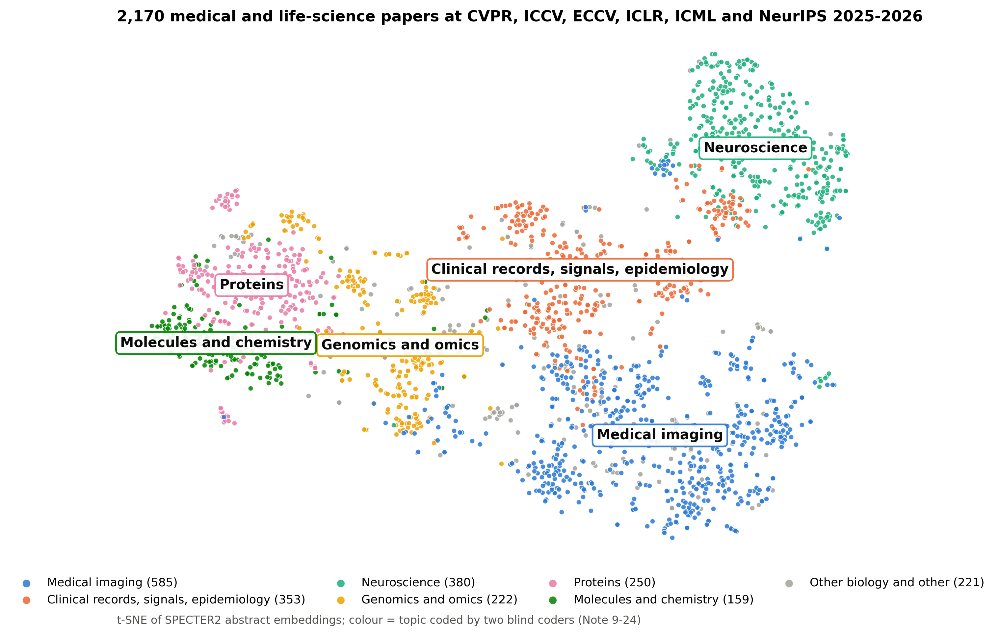
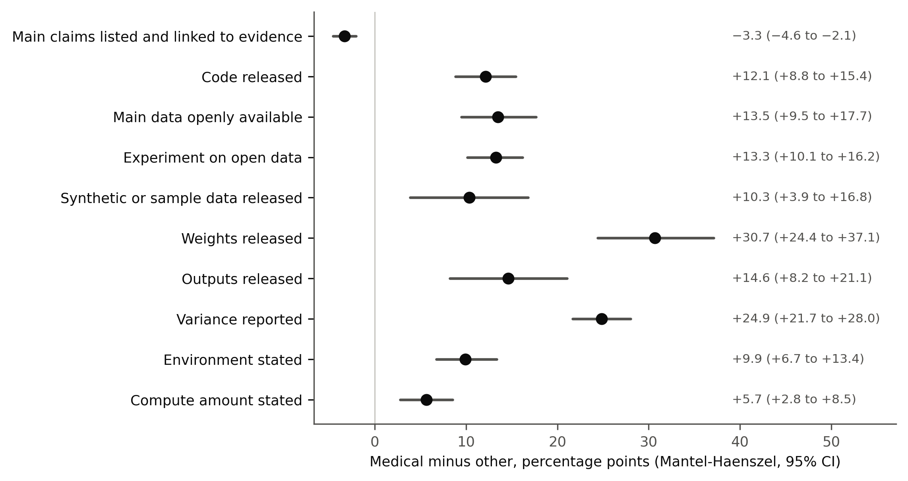
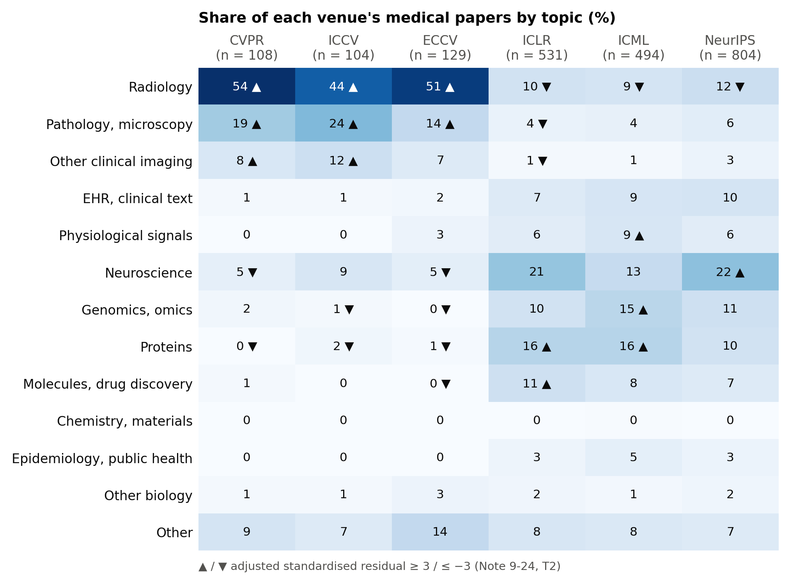
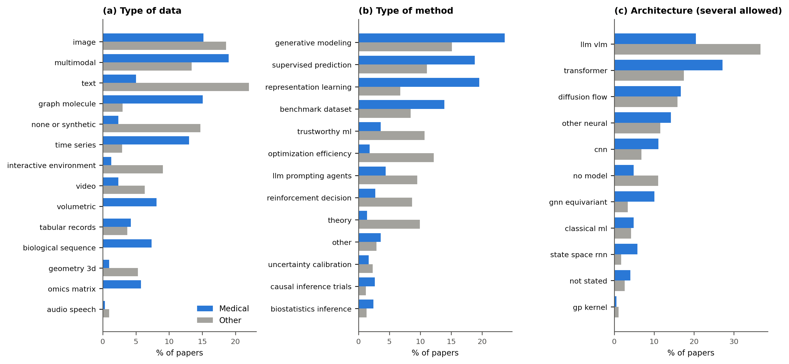

# Life science at ML venues

Do medical and life-science papers at top ML venues report reproducibility practices more often than other papers,
and do agents reproduce them as well? Data, code, frozen protocol and manuscript for:

> Kondrateva E, Kofler F, Simkó A. Reported reproducibility practices and agentic reproduction outcomes in medical
> and life-science papers at major ML conferences: a systematic meta-research study. medRxiv preprint in preparation.

**4,340 papers** (2,170 medical, 2,170 other) from CVPR, ICCV, ECCV, ICLR, ICML and NeurIPS 2025-2026;
**3,787 full texts** coded on twelve practices by two blind LLM coders with adjudication.

**Data:** [dataset on Hugging Face](https://huggingface.co/datasets/kondratevakate/life-science-at-ml-venues)



## Key findings

* Medical papers report releasing **code** (59% vs 47%), **weights**, **open data** and **variance** more often.
* Few papers in either group link their main claims to a specific result (2.5% vs 5.8%).
* In the ICML 2026 agent reproduction challenge, attempted medical papers reached a verdict less often (46% vs 66%).
* Exploratory: within the same type of data, the open-data advantage disappears (Note 9-27).



## What the papers are about






## Where things are


| Path | What |
|---|---|
| [`verdict_audit/readiness/PROTOCOL.md`](verdict_audit/readiness/PROTOCOL.md) | Frozen protocols 7 (medical label), 8 and 9 (this study) with every dated note |
| [`verdict_audit/readiness/results/`](verdict_audit/readiness/results/) | All result files; `p9*.json` are the paper's analyses |
| [`verdict_audit/readiness/results/p9_papers.csv`](verdict_audit/readiness/results/p9_papers.csv) | One row per frame paper (4,340): identifiers, title, group, full-text status, all codes. No abstracts or full texts |
| [`verdict_audit/readiness/codes/`](verdict_audit/readiness/codes/) | Coder prompts, every coder's labels and every adjudication |
| [`manuscript/`](manuscript/) | Manuscript source, figure and table builder (checks every quoted number against the results), Word export, supplementary files |
| [`setup_data.py`](setup_data.py) | Links the downloaded inputs into the paths the frozen scripts expect |
| [`PROVENANCE.md`](PROVENANCE.md) | Where this repository comes from and how to verify the protocol freeze |

<details><summary>Earlier protocols and files not included</summary>

`verdict_audit/e1_adjusted/` and `verdict_audit/falsifiability/` hold earlier protocols (4 and 6) of the same
project. They are here only because the analysis code imports from them.

Two intermediate files of those earlier protocols list the public account names of challenge participants and are
not included here: `audit/public_repro_audit.csv` and `verdict_audit/e1_adjusted/keys/e1_evidence_key.csv`. No
Protocol 9 analysis reads them. Rerunning Protocols 6 and 7 (`verdict_audit/analyze.py`, `analyze_readiness.py`,
the `e1_adjusted` and `falsifiability` scripts) or `tools/check_map_against_labels.py` needs them; they are in
[kondratevakate/icml-2026-repro](https://github.com/kondratevakate/icml-2026-repro) at the commit named in
[`PROVENANCE.md`](PROVENANCE.md).

`posthoc_p9_uptake.py` (Note 9-11) also reads the challenge's `claims_anchored.json` from the repository root. The
committed `results/p9_uptake.json` was computed from the copy downloaded on 2026-07-18, which is not in the shared
data registry. With the registered 2026-10-27 copy (`icml2026-challenge-snapshots/2026-10-27/raw/verdicts/`), which
lists one more paper, the script reproduces every value except one descriptive mean (anchored claims per other
paper, 4.6947 vs 4.6974); no number in the manuscript depends on it.

</details>

<details><summary>Reproduce</summary>


```bash
python -m pip install -r verdict_audit/requirements.txt matplotlib python-docx   # Python 3.11
python setup_data.py --data-root <folder holding datasets/literature/...>
cd verdict_audit/readiness
python analyze_p9.py run && python analyze_p9_claims.py run && python analyze_p9_ext.py run
python posthoc_p9.py && python posthoc_p9_adversarial.py && python posthoc_p9_areas.py
python posthoc_p9_extended.py && python posthoc_p9_more.py && python posthoc_p9_uptake.py && python posthoc_p9_empirical.py
python build_p9_release.py
python -m pytest test_p9.py test_readiness.py
cd ../.. && python manuscript/build_assets.py && python manuscript/build_docx.py
```

On 2026-10-30 these steps reproduced every Protocol 9 result file byte for byte (`p9_manifest.json` differs only in
the commit id and in code hashes, which depend on line endings).

### Inputs not in git

The analyses start from the committed codes; the raw inputs are needed only to rerun them. `setup_data.py` expects:

* `datasets/literature/ml-venue-listings/2024-2026-v1/raw/`: the venue listing files, their abstract companions and
  `papers.json` (built by `download_sources.py`, `fetch_abstracts.py`, `fetch_iclr2026_abstracts.py`), plus the
  coding sheets under `p9/`.
* `datasets/literature/icml2026-challenge-snapshots/2026-10-27/raw/verdicts/verdicts.json`: the challenge verdict
  snapshot (SHA-256 `652f1c16...c526`, checked by `setup_data.py`).
* `datasets/literature/ml-venue-fulltext/2025-2026-v1/`: full texts (`fetch_p9.py`; needed only for excerpts and
  `build_p9_release.py`).

Listing files, abstracts and full texts are not redistributed: they belong to the venues, arXiv and the authors.

</details>

## Licence

Code: MIT ([`LICENSE`](LICENSE)). Text, protocols, coding sheets, the paper table and aggregate results: CC BY 4.0
([`LICENSE-CC-BY-4.0`](LICENSE-CC-BY-4.0)).
